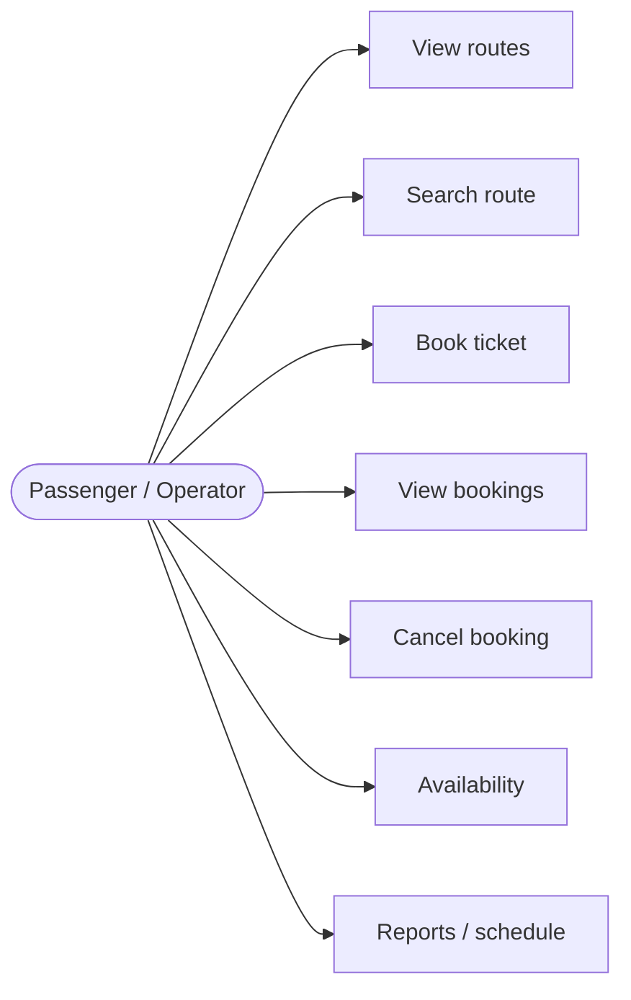
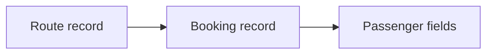
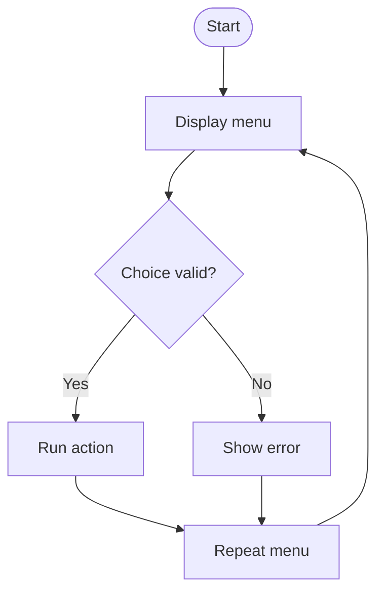
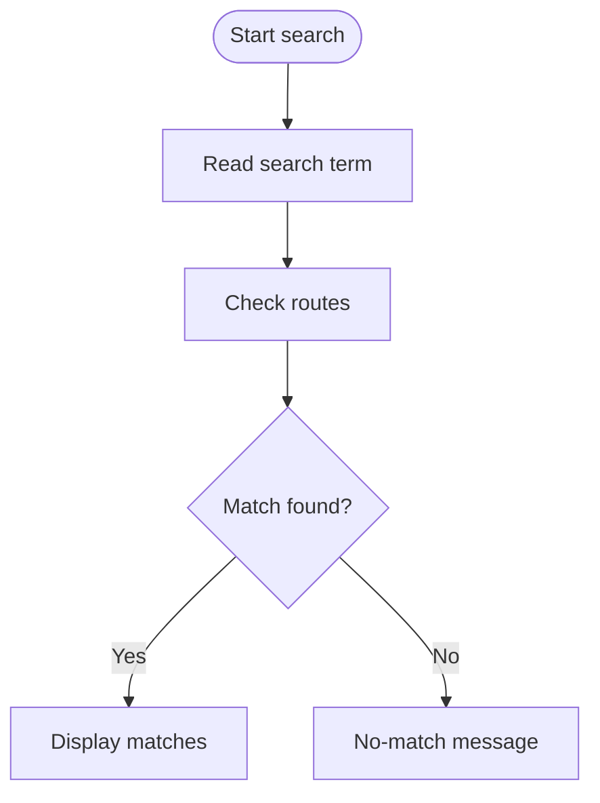
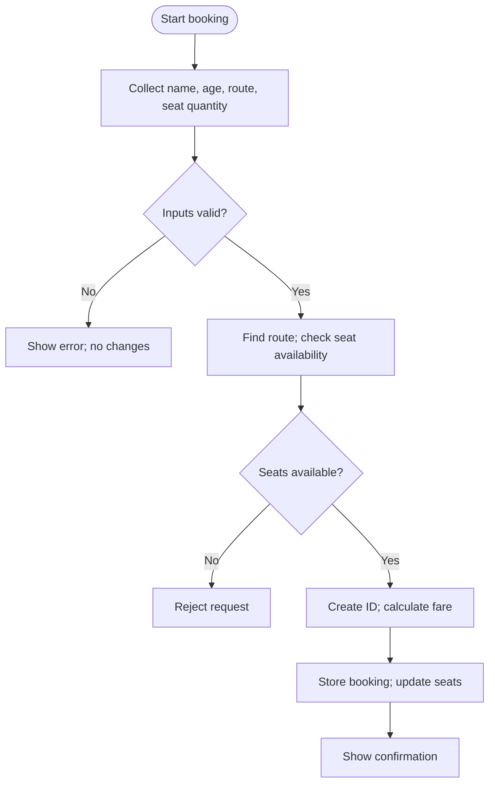
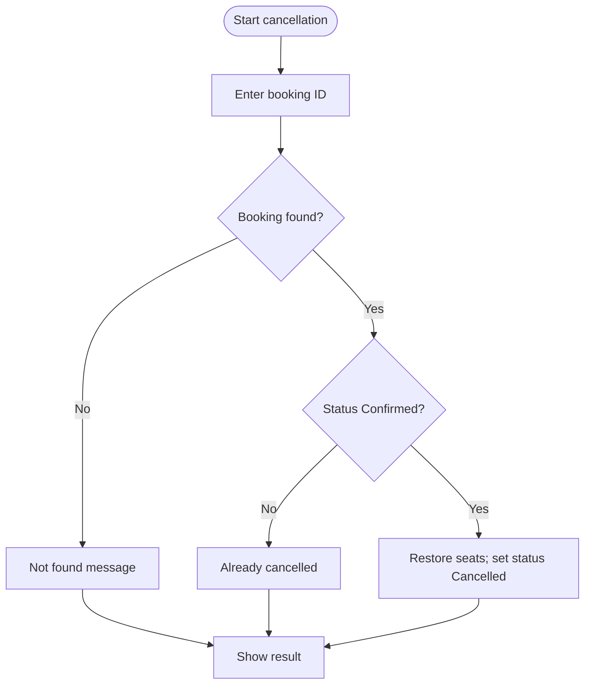
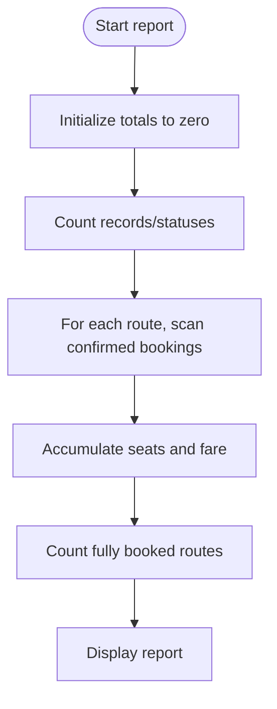

# Smart Bus Ticket Booking & Reservation System

## Product Requirements Document (PRD)

A beginner-friendly blueprint for a Python 3 console application that manages routes, seats, bookings, cancellations, schedules, and reports.

**ROUTES → BOOKINGS → REPORTS**

*Modern transportation • Clear requirements • Built-in Python only*

---

## Document Guide

This PRD describes what the application must do, the rules it must follow, and how students can verify behavior. It is not a complete source-code solution. Sample route values and terminal output are illustrative.

| Section | Contents |
|---|---|
| 01 | Executive Summary |
| 02 | Problem Statement |
| 03 | Product Vision & Objectives |
| 04 | Users & Use Cases |
| 05 | Scope & Constraints |
| 06 | Main Menu & User Interface |
| 07 | Functional Requirements |
| 08 | Data Model & Data Structures |
| 09 | Business Rules & Validation |
| 10 | System Workflows |
| 11 | Required Python Concepts |
| 12 | Technical Requirements |
| 13 | Acceptance Criteria |
| 14 | Testing Plan |
| 15 | Deliverables |
| 16 | Optional Enhancements |
| 17 | Final Project Expectations |

### Terminology

- **Route:** a scheduled journey between cities.
- **Booking:** a reservation record linking a passenger to a route and seat quantity.
- **Confirmed:** active booking.
- **Cancelled:** retained but inactive booking.
- **Available seats:** seats that can still be reserved.

---

## 01 Executive Summary

The Smart Bus Ticket Booking & Reservation System is a text-based Python application for a small bus service. A user works through a console menu to browse routes, search for journeys, reserve seats, inspect bookings, cancel reservations, check availability, and view reports.

It is a learning project that demonstrates how Python data structures and control flow solve a realistic problem. Route and booking records remain in memory while the program runs; they are not automatically saved permanently.

The completed application should deliver an end-to-end reservation workflow: valid requests create unique booking IDs, seat counts stay correct, cancellations restore seats exactly once, and reports exclude cancelled bookings from confirmed revenue.

> **Expected outcome:** A beginner can run the program, complete or cancel a booking, and understand the result from clear console messages.

---

## 02 Problem Statement

A transport operator needs a consistent way to manage routes and reservations. Manual or inconsistent processes can cause duplicate bookings, incorrect seat counts, fare errors, and reports that count cancelled tickets as revenue.

| Area | Problem to prevent | System response |
|---|---|---|
| Routes and schedules | Users cannot compare journeys. | Show route IDs, cities, departure times, fares, and capacity. |
| Passenger records | Details may be incomplete. | Validate and store passenger name and age. |
| Bookings and seats | Requests exceed capacity or conflict. | Check availability before confirming and update once. |
| Fare calculation | Total differs from seat quantity × fare. | Calculate fare consistently. |
| Cancellation | Seats are restored more than once. | Retain record, change status, restore seats once. |
| History and reports | Totals become inconsistent. | Report status, reserved seats, confirmed revenue, and full routes. |

---

## 03 Product Vision & Objectives

**Vision:** provide a small, understandable reservation system that models essential bus-ticket logic without databases, external services, or advanced frameworks.

- Let users browse routes and identify suitable destinations.
- Allow reservations only when the route exists and enough seats are available.
- Generate unique booking IDs during the program run.
- Reject empty names, invalid ages, invalid seat quantities, and unknown route IDs.
- Keep route availability synchronized with confirmed bookings and cancellations.
- Support booking search, cancellation, booking history, schedules, and reports.
- Demonstrate beginner Python concepts in meaningful places.

Functional success is observable: a booking changes availability and appears in records; cancellation changes status and restores seats; reports reflect those changes.

---

## 04 Users & Use Cases

**Primary user:** a passenger or operator using the same console. Login, multiple permission levels, and separate staff accounts are not required.

- Browse routes and compare departure times, prices, and seats.
- Search by route ID, departure city, or destination city.
- Book seats using passenger details and receive a booking ID.
- Review booking records, fares, route information, and status.
- Cancel a booking only when it is Confirmed.
- Check all seat counts or filter routes with seats remaining.
- Generate reports and view schedules grouped by departure city.

### Use-case overview



*Illustrative logic flow; preserve required behavior in your implementation.*

---

## 05 Scope & Constraints

| In scope | Out of scope |
|---|---|
| Python 3 console app; in-memory routes, passenger and booking records; search, schedules, booking, cancellation, fare calculation, seat availability, reports, validation and testing. | GUI, website, mobile app, external database, payment gateway, third-party API, external Python library, or persistence across restarts. |

Records exist only while the program runs. When it ends, data is lost unless persistence is added separately; persistence is not part of the required scope.

> **Scope guardrail:** Optional enhancements are not prerequisites. Keep the core version a manageable console application.

---

## 06 Main Menu & User Interface

Display the menu at startup and after each operation until Exit is selected. Each option should perform one clear action and return a readable result.

```text
SMART BUS RESERVATION SYSTEM
================================
1. View Available Routes
2. Search for a Route
3. Book a Ticket
4. View My Bookings
5. Cancel a Booking
6. View Seat Availability
7. Generate Booking Report
8. Exit
================================
Enter your choice: _
```

| Option | Behavior |
|---|---|
| 1 — View Available Routes | List route details and show available/full status. |
| 2 — Search for a Route | Search by route ID or city; show matches or a no-match message. |
| 3 — Book a Ticket | Collect details, validate, calculate fare, confirm and update seats. |
| 4 — View My Bookings | List all bookings, including cancelled records. |
| 5 — Cancel a Booking | Cancel only an existing Confirmed booking. |
| 6 — View Seat Availability | Show available seats versus total capacity; optionally filter. |
| 7 — Generate Booking Report | Calculate counts, reserved seats, revenue, and fully booked routes. |
| 8 — Exit | End the menu loop cleanly. |

Read choices with `input()`. Handle non-numeric and unsupported choices without crashing. Use a loop for repeated navigation and a clear exit condition.

---

## 07 Functional Requirements

### Feature 1 — Welcome Screen and Main Menu

- Display application name and numbered menu at startup.
- Repeat the menu after each action until Exit is chosen.
- Handle invalid text and unsupported choices with a helpful message.
- Exit cleanly when the designated option is selected.

**Required concepts:** `print()`, `input()`, `while`, `if`, `elif`, `else`, `break`, and `continue`.

### Feature 2 — Store Bus Routes

Each route needs a unique route ID, departure city, destination city, departure time, ticket price, total seats, and available seats. Store routes as a list of dictionaries.

```python
routes = [
    {
        "route_id": "R101",
        "departure_city": "Karachi",
        "destination_city": "Hyderabad",
        "departure_time": "08:00 AM",
        "ticket_price": 1200,
        "total_seats": 40,
        "available_seats": 40
    },
    # Add the other sample route dictionaries.
]
```

Five fictional starter routes follow. Values are illustrative sample product data. R101 uses Rs. 1,200 per seat so Ahmed's two-seat example totals Rs. 2,400.

| Route ID | Departure | Destination | Departure time | Fare Rs. | Total | Available |
|---|---|---|---|---|---|---|
| R101 | Karachi | Hyderabad | 08:00 AM | 1,200 | 40 | 40 |
| R102 | Karachi | Sukkur | 09:30 AM | 2,000 | 36 | 36 |
| R103 | Hyderabad | Mirpur Khas | 11:00 AM | 800 | 32 | 32 |
| R104 | Karachi | Lahore | 07:00 PM | 5,000 | 45 | 45 |
| R105 | Sukkur | Hyderabad | 02:00 PM | 1,500 | 30 | 30 |

A tuple can hold supported cities, e.g. `('Karachi', 'Hyderabad', 'Sukkur', 'Mirpur Khas', 'Lahore')`. Use a set for issued booking IDs, and lists/dictionaries for passenger and reservation records.

### Feature 3 — View Available Routes

- Display a sequence number, route ID, journey, departure time, fare, and seats available.
- Use `enumerate()` and a `for` loop to number and inspect route records.
- Use `continue` to skip fully booked routes when the user requests an available-only filter.
- Show **Fully Booked** when available seats equal zero.

```text
AVAILABLE BUS ROUTES
No.  Route  Journey                  Depart     Fare      Seats
1    R101   Karachi -> Hyderabad     08:00 AM   Rs.1200   40/40
2    R102   Karachi -> Sukkur        09:30 AM   Rs.2000   36/36
3    R103   Hyderabad -> Mirpur Khas 11:00 AM   Rs.800    32/32
4    R104   Karachi -> Lahore        07:00 PM   Rs.5000   45/45
5    R105   Sukkur -> Hyderabad      02:00 PM   Rs.1500   30/30
```

### Feature 4 — Search for a Route

- Search by route ID, departure city, or destination city.
- Normalize city input, for example with `lower()`, for case-insensitive matching.
- Show all matching city results; stop after a unique route ID match when appropriate.
- Use `for-else` to show a no-match message when a loop completes without `break`.

```text
Search by route ID or city: hyderabad
R101 | Karachi -> Hyderabad | Rs. 1200 | 40 seats available
R103 | Hyderabad -> Mirpur Khas | Rs. 800 | 32 seats available
R105 | Sukkur -> Hyderabad | Rs. 1500 | 30 seats available
```

### Feature 5 — Book a Ticket

Collect passenger name, passenger age, route ID, and number of seats. Validate every field before changing availability or creating a confirmed booking.

| Rule | Expected behavior |
|---|---|
| Name | Reject empty or whitespace-only input. |
| Age | Require a positive integer; reject text, zero, or negatives. |
| Route ID | Require an existing route. |
| Seat quantity | Require an integer greater than zero. |
| Availability | Reject requests greater than available seats. |
| Booking ID | Generate an ID not already in the booking-ID set. |
| Fare | Total fare = ticket price × seats. |
| Update order | Create record and decrement seats only after all checks pass. |
| Stored fields | Passenger details, route ID, seats, total fare, booking ID, Confirmed status. |

**Successful booking example**

```text
Booking confirmed!
Booking ID: B1001
Passenger: Ahmed
Route: R101 (Karachi -> Hyderabad)
Seats booked: 2
Fare per seat: Rs. 1200
Total fare: Rs. 2400
Status: Confirmed
```

**Required concepts:** variables, lists, dictionaries, sets, nested conditions, `break`, and `continue`. A failed check must not change seat counts or create a confirmed booking.

### Feature 6 — View My Bookings

- Use `enumerate()` and `for` to number records.
- Show booking ID, passenger, route, seats, fare, and status.
- Keep cancelled records visible in history.
- Show `No bookings found.` when the list is empty.

### Feature 7 — Cancel a Booking

Find a booking by ID. Only a Confirmed record can be cancelled. Retain the original record, set status to Cancelled, and restore its seat quantity to the route once.

| Rule | Expected behavior |
|---|---|
| Booking ID must exist | If not found, report it and change nothing. |
| Only Confirmed | Reject cancellation for Cancelled records. |
| No repeated cancellation | Do not restore seats a second time. |
| Restore correct seats | Add the booking's seat quantity to the original route. |
| Retain record | Keep the record for history and reporting. |

```text
Enter booking ID to cancel: B1001
Booking B1001 has been cancelled.
Seats restored: 2
Route R101 available seats: 40
```

Use `for`, `for-else`, nested conditions, `break`, and variables. Change status and seat availability as one logical operation.

### Feature 8 — View Seat Availability

- Show available seats and total capacity for every route.
- **Available** = all seats remain; **Partially Booked** = some seats remain; **Fully Booked** = zero seats remain.
- Offer a filter for routes with seats available.
- Maintain `0 ≤ available seats ≤ total seats`.

### Feature 9 — Generate Booking Report

| Report field | Calculation |
|---|---|
| Total bookings created | Count every record, including cancelled. |
| Confirmed bookings | Count Confirmed records. |
| Cancelled bookings | Count Cancelled records. |
| Seats currently reserved | Sum seats from Confirmed records only. |
| Confirmed revenue | Sum fare from Confirmed records only; exclude cancelled. |
| Fully booked routes | Count routes with zero available seats. |

Use nested loops to group confirmed bookings by route: outer loop visits routes, inner loop checks matching confirmed bookings. With no bookings, booking totals and revenue are zero; route status is still counted.

```text
BOOKING REPORT
Total bookings created: 3
Confirmed bookings: 2
Cancelled bookings: 1
Seats currently reserved: 5
Confirmed revenue: Rs. 6,000
Fully booked routes: 1
```

*(Illustrative output; actual totals depend on current records.)*

### Feature 10 — Route Schedule

Use an outer loop over supported cities and an inner loop over routes. Print routes whose departure city matches the current city. If no route departs from a city, display `No scheduled departures.`

```text
ROUTE SCHEDULE BY DEPARTURE CITY
Karachi
  R101 -> Hyderabad | 08:00 AM
  R102 -> Sukkur | 09:30 AM
  R104 -> Lahore | 07:00 PM
Hyderabad
  R103 -> Mirpur Khas | 11:00 AM
Sukkur
  R105 -> Hyderabad | 02:00 PM
Mirpur Khas
  No scheduled departures.
Lahore
  No scheduled departures.
```

---

## 08 Data Model & Data Structures

| Structure / type | Purpose | Example |
|---|---|---|
| List | Ordered collection of routes or bookings. | `routes = [...]` |
| Dictionary | Named fields for each route or booking. | `{'route_id': 'R101'}` |
| Tuple | Supported cities collection. | `('Karachi', 'Sukkur')` |
| Set | Tracks issued booking IDs. | `{'B1001', 'B1002'}` |
| String | Names, cities, IDs, statuses. | `'Confirmed'` |
| Integer | Age, seat counts, quantities. | `seats = 2` |
| Float or integer | Ticket fares and totals; integer rupees work for samples. | `1200 * 2` |
| Boolean | True/false logical states. | `is_available = True` |

### Conceptual relationship



*Illustrative logic flow; preserve required behavior in your implementation.*

A booking references a route by route ID and stores passenger details. This is a conceptual relationship implemented with Python data structures, not a database.

### Recommended booking record

```python
booking = {
    "booking_id": "B1001",
    "passenger_name": "Ahmed",
    "passenger_age": 24,
    "route_id": "R101",
    "seats": 2,
    "total_fare": 2400,
    "status": "Confirmed"
}
```

Field names can vary if the implementation consistently retains equivalent information.

---

## 09 Business Rules & Validation

Validate first, then change state only when an operation can succeed.

| Rule ID | Business rule | Expected system behavior |
|---|---|---|
| BR-01 | Passenger name required. | Reject blank name. |
| BR-02 | Age positive integer. | Reject text, zero, negatives. |
| BR-03 | Route must exist. | No booking or seat change for unknown route. |
| BR-04 | Seat quantity positive integer. | Reject invalid quantity. |
| BR-05 | Requested seats ≤ availability. | Reject without changing data. |
| BR-06 | Booking IDs unique. | Check set before issuing ID. |
| BR-07 | Fare = price × seats. | Calculate and store correct total. |
| BR-08 | Seats change only on valid booking. | Subtract once after validation. |
| BR-09 | Only Confirmed booking can be cancelled. | Reject cancelled record. |
| BR-10 | Restore seats once. | Set Cancelled status and prevent repeat. |
| BR-11 | Keep booking history. | Do not delete cancelled record. |
| BR-12 | Exclude cancelled fare from revenue. | Sum Confirmed records only. |
| BR-13 | Availability within capacity. | Keep 0 ≤ available ≤ total. |
| BR-14 | Menu choice supported. | Handle invalid text/range safely. |
| BR-15 | Empty lists are valid. | Show helpful messages or zero totals. |

> **State consistency:** Never decrement seats before validation passes. Never restore seats unless a Confirmed booking changes to Cancelled. This prevents overbooking and double restoration.

---

## 10 System Workflows

Diagrams show expected control flow, not mandatory code structure. Rounded rectangles represent start/end, rectangles represent processing, diamonds represent decisions, and arrows show flow.

### A — Main menu and navigation



The program displays the menu, validates the choice, runs the action or shows an error, then returns to the menu. Exit ends the loop.

### B — Route search



City search should continue to find all matches. A unique route ID search may use `break`. A `for-else` block can display the no-match message.

### C — Ticket booking and validation



Do not update seats or create a confirmed record until input, route existence, seat quantity, and capacity checks pass.

### D — Booking cancellation



### E — Booking report generation



A report with no bookings should still display zero booking counts, zero reserved seats, and zero confirmed revenue. Fully booked routes are counted from route availability.

---

## 11 Required Python Concepts

Use each concept where it supports understandable behavior; students should explain why it belongs in the application.

| Concept | Where and why it is used |
|---|---|
| `print()` and `input()` | Display menus/results and collect user input. |
| Variables and basic data types | Hold selections, passenger values, seat quantity, fare, and report totals. |
| Strings, integers, floats, booleans | Strings for IDs/status; integers for age/seats; numeric fares; booleans for logical checks. |
| Lists | Store multiple route and booking dictionaries. |
| Dictionaries | Keep related route or booking fields together. |
| Tuples | Represent supported cities. |
| Sets | Track issued IDs and prevent duplicates. |
| `if`, `elif`, `else` | Select menu actions, classify statuses, handle valid/invalid cases. |
| Nested conditions | Validate route, seat quantity, and capacity. |
| `for` loops | Visit routes, bookings, or cities. |
| Nested `for` loops | Group bookings by route and build city schedules. |
| `for-else` | Handle not-found results when no `break` occurs. |
| `break` | Stop unique ID search or exit the menu loop. |
| `continue` | Skip fully booked routes or restart after invalid input. |
| `enumerate()` | Number route and booking listings. |
| `while` loops | Repeat menu navigation until Exit. |
| Fare calculations | Multiply fare per seat by requested seats. |
| Input validation | Reject blank names, invalid numbers, unknown routes, and excessive seat requests. |

---

## 12 Technical Requirements

| Requirement | Specification |
|---|---|
| Language | Python 3. |
| Libraries | Built-in Python functionality only; no external packages. |
| Interface | Console text menu and messages. |
| Storage | In-memory data only; no database or persistent storage. |
| Code clarity | Descriptive names, consistent indentation, readable operations, useful comments. |
| Validation | Safely handle numeric conversion and invalid input. |
| State correctness | Keep availability, booking status, unique IDs, and totals consistent. |
| Maintainability | Keep route lookup, booking, cancellation, and reporting understandable. |
| Student understanding | Students can explain their implementation and decisions. |

---

## 13 Acceptance Criteria

The application is complete when the following observable conditions are satisfied:

- [ ] At least five routes are displayed.
- [ ] Route searches return matches or a helpful no-match message.
- [ ] Valid bookings generate unique IDs.
- [ ] Invalid passenger information is rejected without changing data.
- [ ] Booking more seats than available is rejected.
- [ ] Seat counts update correctly after booking.
- [ ] A booking can be cancelled only once.
- [ ] Cancelled seats are restored correctly.
- [ ] Cancelled bookings are excluded from confirmed revenue.
- [ ] Route schedules use nested loops.
- [ ] `enumerate()`, `for-else`, `break`, and `continue` are used meaningfully.
- [ ] Empty records and invalid menu choices are handled correctly.

---

## 14 Testing Plan

Run each scenario and compare actual behavior with the expected result. Record the actual result in `test_cases.txt`.

| Test ID | Scenario | Input / action | Expected result |
|---|---|---|---|
| TC-01 | View all routes | Choose View Available Routes. | All five routes and seat status appear. |
| TC-02 | Search Hyderabad | Search city Hyderabad. | Routes departing from or arriving at Hyderabad appear. |
| TC-03 | Unknown city | Search Atlantis. | No-match message; program continues. |
| TC-04 | Book two seats | Ahmed, valid age, R101, 2 seats. | Booking confirmed for Rs. 2,400; R101 availability drops by 2. |
| TC-05 | Zero seats | Attempt booking with 0 seats. | Reject; no booking or seat change. |
| TC-06 | Too many seats | Request more than available. | Reject; availability never becomes negative. |
| TC-07 | Cancel confirmed booking | Enter a Confirmed booking ID. | Status changes and correct seats are restored. |
| TC-08 | Cancel same booking again | Repeat cancelled ID. | Reject; no additional seat restoration. |
| TC-09 | Report with no bookings | Generate report from empty list. | Booking totals/revenue zero; route status still counted. |
| TC-10 | Book all seats | Request exactly remaining seats. | Booking succeeds; availability zero; Fully Booked status. |
| TC-11 | Report after cancellation | Cancel booking, then report. | Cancelled count increases; cancelled fare excluded. |
| TC-12 | Invalid menu option | Enter unsupported text/number. | Helpful error; program returns to menu. |

### Testing notes

- Use a fresh session when a clean in-memory state is required.
- Test boundary values: zero seats, exactly all seats, and one more than available.
- Check both the displayed message and the resulting state.
- Confirm cancelled bookings remain visible with Cancelled status.
- Reconcile report totals with Confirmed records.

---

## 15 Deliverables

| Deliverable | Required content |
|---|---|
| `main.py` | Complete runnable Python source: route data, menu, validation, booking, cancellation, availability, schedule, and reports. |
| `README.md` | Purpose, Python requirement, run instructions, menu guide, sample workflow, storage limitation, and constraints. |
| `test_cases.txt` | Scenario, input/action, expected result, actual result, and whether it matched; include the required tests. |
| Screenshots | Clear views of route listing, successful booking, cancellation, and report output. |
| Demonstration | Explain program flow, data structures, validation, seat updates, cancellation, and report calculations. |

Keep README and screenshots honest about the in-memory storage limitation: records are not retained after the application closes.

---

## 16 Optional Enhancements

These are optional, not mandatory. Complete and test all core features before attempting them.

| Enhancement | Description |
|---|---|
| 10% discount for four or more seats | Apply discount to a booking of at least four seats; show subtotal, discount, and final fare. |
| Fare categories for children/adults | Let category affect fare; define rules before implementation. |
| Most popular route | Calculate route popularity by confirmed bookings or seats booked; state the measure. |
| Prevent duplicate seat numbers | Track individual seat numbers and prevent double assignment; this adds complexity. |
| Search by passenger name | Find bookings using case-insensitive passenger-name matching. |
| Revenue by departure city | Group confirmed revenue by departure city, excluding cancelled bookings. |

Optional features must not break required behavior. If a discount is implemented, define whether stored fare means the final charged fare and keep cancellation/report calculations consistent.

---

## 17 Final Project Expectations

Students should write their own code and understand the logic they submit. A working application is more than a menu that prints text: every option must perform its described action and preserve consistent state.

- Explain why lists, dictionaries, tuples, and sets are used.
- Walk through booking input, validation, fare calculation, record creation, and seat update.
- Explain cancellation, status change, one-time seat restoration, and retained history.
- Explain reserved-seat and confirmed-revenue totals, excluding cancelled records.
- Demonstrate meaningful loops, nested loops, `for-else`, `enumerate()`, `break`, and `continue`.
- Show invalid input, empty records, and boundary cases without crashing.

> **Definition of done:** The final application demonstrates a working, tested bus-ticket reservation workflow using beginner-level Python fundamentals, accurate availability, reliable cancellation, and understandable reports.

---

## Appendix — Implementation Reminders

| Before confirming a booking | Before completing a cancellation | Before finalizing a report |
|---|---|---|
| Validate fields and route; check seat capacity and unique ID; calculate fare; create record then decrement availability. | Find record; verify Confirmed; restore its seats; set Cancelled; never repeat restoration. | Count all records; separate statuses; sum seats and fare for Confirmed only; count routes with zero seats. |

*End of Product Requirements Document*
